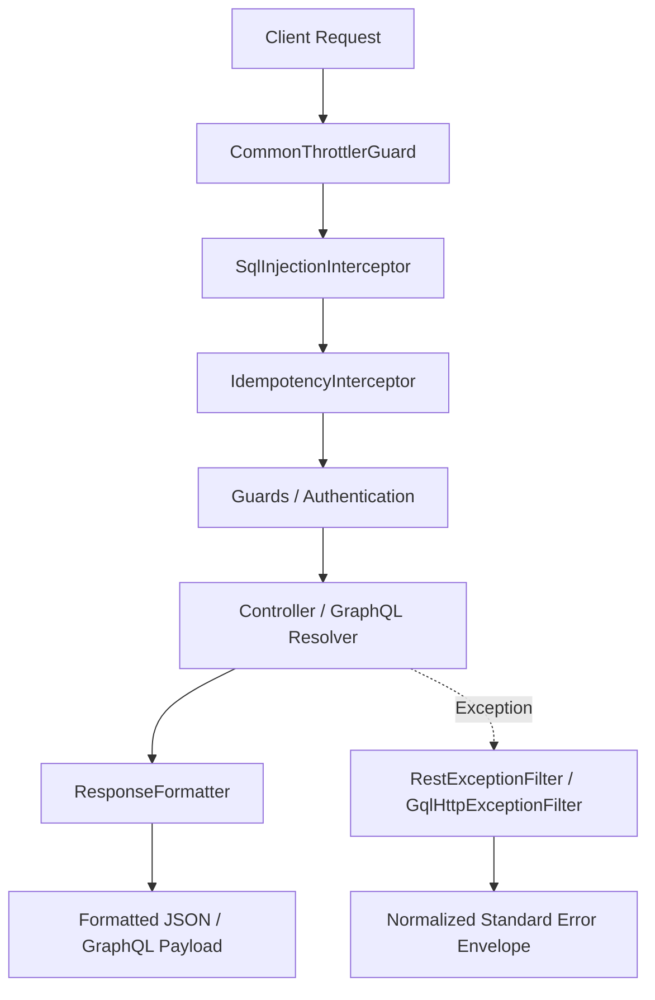
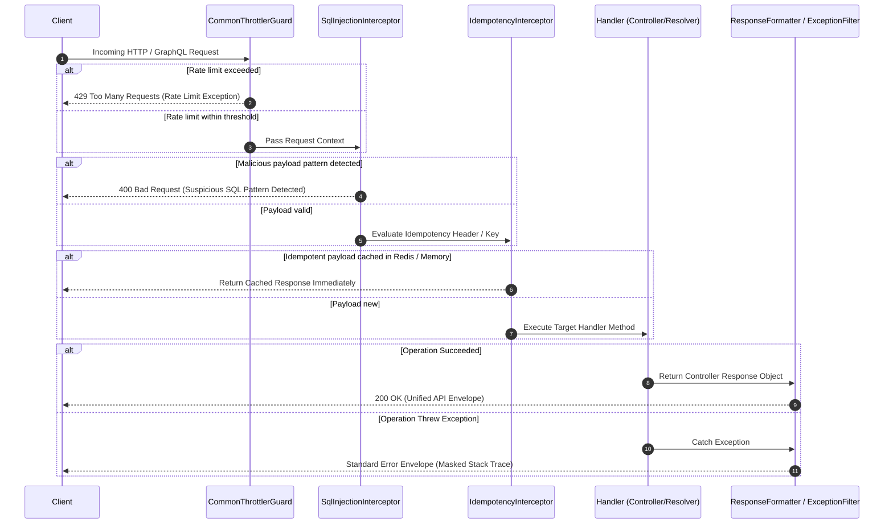
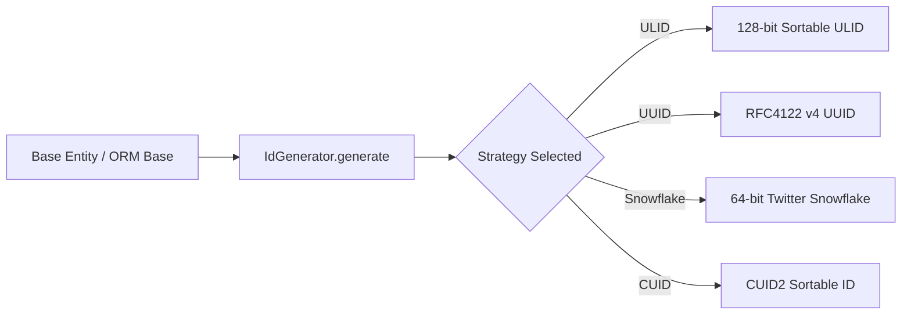

# BTS Soft — NestJS Enterprise Infrastructure Ecosystem

**Author: [Omar Sabry](https://omarsabry.vercel.app/) — Full Stack Engineer**

[](https://opensource.org/licenses/MIT)
[](https://nodejs.org)
[](https://nestjs.com)
[](https://www.typescriptlang.org)

---

## What is BTS Soft?

BTS Soft is a collection of production-grade NestJS infrastructure packages built to eliminate boilerplate across microservices and monoliths. Every package is protocol-agnostic (REST and GraphQL), security-hardened by default, and independently publishable on npm.

The ecosystem was designed with three guiding principles:

- **Security by Default** — SQL injection scanning, rate limiting, and response sanitization are active from the moment the application starts. No configuration required.
- **Protocol Agnosticism** — Validation decorators, response envelopes, and rate limiters work identically on Express REST APIs and Apollo GraphQL servers.
- **Extensibility Without Coupling** — Storage providers, notification channels, and ID generation strategies are swappable through environment variables and interface implementations, not code changes.

---

## Package Registry

| Package | Version | npm | Description |
| :--- | :--- | :--- | :--- |
| **@bts-soft/core** |  | [npm](https://www.npmjs.com/package/@bts-soft/core) | Meta-package bundling all five sub-packages |
| **@bts-soft/validation** |  | [npm](https://www.npmjs.com/package/@bts-soft/validation) | Composite validation decorators, rate limiters, SQL injection guards |
| **@bts-soft/cache** |  | [npm](https://www.npmjs.com/package/@bts-soft/cache) | Enterprise Redis abstraction with 15 domain services |
| **@bts-soft/notifications** |  | [npm](https://www.npmjs.com/package/@bts-soft/notifications) | Multi-channel queued notification engine |
| **@bts-soft/upload** |  | [npm](https://www.npmjs.com/package/@bts-soft/upload) | Chunked media uploads with CDN integration |
| **@bts-soft/common** |  | [npm](https://www.npmjs.com/package/@bts-soft/common) | Standard library: interceptors, ORM adapters, infrastructure modules |

---

## Repository Structure

```
packages/
  core/           @bts-soft/core        Meta-package re-exporting all sub-packages
  validation/     @bts-soft/validation  Validation decorators and rate limiters
  cache/          @bts-soft/cache       Redis facade
  notifications/  @bts-soft/notifications  Notification engine
  upload/         @bts-soft/upload      Upload orchestration
  common/         @bts-soft/common      Standard library
```

---

## System Architecture

### How the Packages Relate

```
                    @bts-soft/core (Meta-Package)
                            |
        ┌───────────────────┼───────────────────┐
        │                   │                   │
@bts-soft/validation  @bts-soft/notifications  @bts-soft/upload
Decorators            Queued Multi-Channel      Chunked Upload
Rate Limiters         Engine                    CDN
SQLi Guards                │                       │
        │                  └─────────┐  ┌───────────┘
        │                            ▼  ▼
@bts-soft/common              @bts-soft/cache
Interceptors                  Redis Facade
ORM Adapters         ◄────── 15 Domain Services
Infrastructure Modules       (shared by all packages)
```

The cache package is the shared infrastructure dependency. Notifications use BullMQ queues backed by Redis. Upload uses a Redis Token Bucket for rate limiting and BullMQ for asynchronous chunk merging. The common package uses Redis for distributed locking and idempotency. The validation package uses Redis for distributed rate limiter storage.

### Request Lifecycle

```
Client ──► CommonThrottlerGuard ──[rate limit exceeded]──► 429 Too Many Requests
                │
         [within threshold]
                │
                ▼
        SqlInjectionInterceptor ──[SQLi detected]──► 400 Bad Request
                │
          [payload clean]
                │
                ▼
       IdempotencyInterceptor ──[duplicate key in Redis]──► Cached Response
                │
          [new request]
                │
                ▼
         NestJS ValidationPipe  (validate + transform DTO)
                │
                ▼
          Controller / Resolver
                │
                ▼
    GeneralResponseInterceptor  (wrap in unified envelope)
                │
                ▼
     Client  ◄── { success, statusCode, data, timeStamp }
```

---

## Quick Installation

**Install the entire ecosystem with one command:**

```bash
npm install @bts-soft/core
```

**Or install individual packages as needed:**

```bash
npm install @bts-soft/cache
npm install @bts-soft/validation
npm install @bts-soft/notifications
npm install @bts-soft/upload
npm install @bts-soft/common
```

Peer dependencies for all packages:

```bash
npm install @nestjs/common @nestjs/core
```

---

## Package Summaries

### @bts-soft/validation

Composite validation decorators that combine `class-validator` structural checks, `class-transformer` normalizations (lowercase email, title-case names), and SQL injection prevention into a single annotation. Protocol-agnostic: the same decorator works on REST DTOs and GraphQL `@InputType()` classes.

Also includes a pluggable rate-limiting guard implementing five algorithms: Token Bucket, Leaking Bucket, Fixed Window Counter, Sliding Window Log, and Sliding Window Counter. Storage auto-negotiates between Redis and in-memory based on availability.

```typescript
import { NameField, EmailField, PasswordField, PasswordComplexity } from '@bts-soft/validation';

export class RegisterUserDto {
  @NameField('Full Name', 2, 80, false, false, false)
  name: string; // "omar sabry" -> "Omar Sabry"

  @EmailField(false, false, false)
  email: string; // "USER@Mail.COM" -> "user@mail.com"

  @PasswordField(12, 32, PasswordComplexity.COMPREHENSIVE, false, false, false)
  password: string;
}
```

**Read more:** [packages/validation](./packages/validation/README.md)

---

### @bts-soft/cache

Enterprise Redis abstraction built on the Modular Facade Pattern. A single `RedisService` injectable provides access to 15 internally decoupled domain services covering every Redis data structure and operation type.

Key capabilities: automatic JSON serialization, atomic distributed locking via Lua scripts, isolated Pub/Sub subscriber connections, Redis Streams with Consumer Groups, Bitmap DAU tracking, HyperLogLog probabilistic counting, geospatial proximity queries, and atomic pipeline transactions.

```
                    RedisService (Facade)
                            │
   ┌──────────┬─────────────┼─────────────┬──────────┐
   ▼          ▼             ▼             ▼          ▼
CoreRedis  LockRedis   PubSubRedis  SortedRedis  BitmapRedis
set/get    acquireLock  publish      zAdd          setBit
del/mSet   releaseLock  subscribe    zRevRange     bitCount
getOrSet   waitForLock  pSubscribe   zRank         bitOp
   │          │             │             │          │
   └──────────┴─────────────┴─────────────┴──────────┘
   ┌──────────┬─────────────┐
   ▼          ▼             ▼
StreamRedis  GeoRedis  HyperLogLog
xAdd         geoAdd    pfAdd
xGroupCreate geoDist   pfCount
xReadGroup   geoPos    pfMerge
```

**Read more:** [packages/cache](./packages/cache/README.md)

---

### @bts-soft/notifications

A multi-channel notification engine processing all messages through BullMQ queues backed by Redis. The API returns immediately after enqueuing; external provider calls (Twilio, Firebase, SMTP, Telegram, etc.) happen asynchronously with automatic exponential backoff retries.

The pre-flight pipeline validates expiry, deduplicates by idempotency key, respects user opt-out preferences, and enforces per-recipient per-channel rate limits — all before a job reaches the queue.

```
notificationService.send()
        │
        ▼  PRE-FLIGHT (synchronous)
  ┌──────────────────────────────────────────────┐
  │  Duplicate key? ──[yes]──► Skip DUPLICATE    │
  │  Rate limited?  ──[yes]──► Skip RATE_LIMITED │
  │  [pass] ──► Enqueue BullMQ Job               │
  └──────────────────────────────────────────────┘
        │  API returns 200 immediately
        ▼  WORKER (asynchronous)
  Render template ──► Resolve channel ──► Dispatch
        ├── [Success]    ──► Update log SENT
        └── [5xx error]  ──► BullMQ exponential retry (5s → 10s → 20s)
```

Supported channels: Email (SMTP, SES, SendGrid), SMS (Twilio, SMS Misr, Vonage), WhatsApp, Firebase FCM, Telegram, Discord, Microsoft Teams, Facebook Messenger, Slack, OneSignal, Web Push (VAPID), In-App (Pusher), and generic Webhooks.

**Read more:** [packages/notifications](./packages/notifications/README.md)

---

### @bts-soft/upload

Media orchestration library for NestJS built on the Strategy, Command, and Observer patterns. Supports single-file uploads and resumable chunked uploads for large files, with real-time progress streaming via Server-Sent Events.

The strategy pattern means switching between Local Disk and Cloudinary storage requires only an environment variable change. Upload observers receive lifecycle events (success, failure, deletion) enabling auditing and cleanup without coupling to the core service.

```
Client ──► RateLimiterService (Token Bucket)
                │
                ├── [rate limited] ──► 429
                ▼
         FileValidatorService (extension + size)
                │
                ├──► UploadService (single file)
                │         └──► Strategy: Local or Cloudinary
                │
                └──► ChunkedUploadService (large files)
                          └── [last chunk] ──► BullMQ Queue
                                                    │
                                             UploadProcessor
                                                    │
                                          Merge ──► Strategy
                                                    │
                                          SSE Progress ──► Client
```

**Read more:** [packages/upload](./packages/upload/README.md)

---

### @bts-soft/common

The standard library of the ecosystem. Provides everything that every NestJS service needs without being tied to a specific domain.

- **Global interceptors:** `ClassSerializerInterceptor`, `SqlInjectionInterceptor`, `GeneralResponseInterceptor`
- **Standard response envelope:** Uniform JSON structure for all REST and GraphQL responses
- **Base entities and ORM adapters:** Agnostic base, TypeORM, Mongoose, Sequelize, and Prisma adapters
- **ID generation:** ULID (default), UUID v4, Twitter Snowflake, CUID2 — switchable at runtime
- **Infrastructure modules:** `ThrottlingModule`, `GraphqlModule` (Apollo with WebSocket + Federation), `TranslationModule` (nestjs-i18n)
- **Resilience:** `IdempotencyInterceptor` and `@DistributedLock()` decorator for critical section coordination

```typescript
import { setupInterceptors, displayAppBanner } from '@bts-soft/common';

async function bootstrap() {
  const app = await NestFactory.create(AppModule);
  setupInterceptors(app); // Activates ClassSerializer, SQLi, and GeneralResponse interceptors
  await app.listen(3000);
  displayAppBanner('My Service', 3000);
}
```

**Read more:** [packages/common](./packages/common/README.md)

---

## Design Patterns Reference

| Pattern | Package | Purpose |
| :--- | :--- | :--- |
| **Facade** | `@bts-soft/cache` | Single `RedisService` over 15 internal domain services |
| **Strategy** | `@bts-soft/upload` | Pluggable storage backends (Local, Cloudinary) |
| **Strategy** | `@bts-soft/common` | Pluggable ID generators (ULID, UUID, Snowflake, CUID2) |
| **Command** | `@bts-soft/upload` | Per-media-type upload commands with isolated logic |
| **Observer** | `@bts-soft/upload` | Upload lifecycle event broadcasting |
| **Chain of Responsibility** | `@bts-soft/common` | Ordered interceptor chain on every request |
| **Adapter** | `@bts-soft/common` | ORM-specific base entity adapters |
| **Decorator** | `@bts-soft/validation` | Composite validation and metadata annotations |
| **Proxy** | `@bts-soft/common` | Idempotency deduplication via cached responses |
| **Factory** | `@bts-soft/common` | Dynamic module instantiation for infrastructure modules |

---

## Security Architecture

```
Internet Traffic
      │
      ▼
ThrottlingModule          (rate limiting)
      │
      ▼
SqlInjectionInterceptor   (recursive payload scanning)
      │
      ▼
ValidationPipe            (composite decorator constraints)
      │
      ▼
DistributedLockService    (critical section guard)
      │
      ▼
Business Logic
      │
      ▼
ClassSerializerInterceptor (strip @Exclude() fields)
      │
      ▼
Client Response
```

| Layer | What it blocks |
| :--- | :--- |
| `ThrottlingModule` | DDoS, brute force, noisy neighbor attacks |
| `SqlInjectionInterceptor` | SQL injection, stacked queries, time-delay attacks (`WAITFOR DELAY`, `pg_sleep`), `xp_cmdshell` |
| `ValidationPipe` | Type coercion attacks, length violations, malformed inputs |
| `DistributedLockService` | Race conditions across horizontal service replicas |
| `ClassSerializerInterceptor` | Sensitive field leakage (passwords, internal IDs, raw DB columns) |
| `FileValidatorService` | Extension whitelist bypass, disk exhaustion via oversized uploads |

---

## Environment Variable Quick Reference

### Redis (required by cache, notifications, upload, common)

| Variable | Default | Description |
| :--- | :--- | :--- |
| `REDIS_HOST` | `localhost` | Redis hostname |
| `REDIS_PORT` | `6379` | Redis port |
| `REDIS_PASSWORD` | — | Authentication password |
| `REDIS_DB` | `0` | Database index |
| `REDIS_TTL` | `3600` | Default TTL in seconds |

### Email

| Variable | Description |
| :--- | :--- |
| `EMAIL_HOST`, `EMAIL_PORT`, `EMAIL_USER`, `EMAIL_PASS`, `EMAIL_SENDER` | SMTP configuration |
| `EMAIL_PROVIDER` | `nodemailer`, `twilio-mail`, or `ses` |
| `SENDGRID_API_KEY` | SendGrid API key |
| `AWS_SES_ACCESS_KEY_ID`, `AWS_SES_SECRET_ACCESS_KEY`, `AWS_SES_REGION` | Amazon SES |

### SMS and Messaging

| Variable | Description |
| :--- | :--- |
| `TWILIO_ACCOUNT_SID`, `TWILIO_AUTH_TOKEN`, `TWILIO_SMS_NUMBER`, `TWILIO_WHATSAPP_NUMBER` | Twilio |
| `SMS_PROVIDER` | `twilio`, `smsmisr`, or `vonage` |
| `TELEGRAM_BOT_TOKEN` | Telegram Bot API |
| `DISCORD_WEBHOOK_URL` | Discord webhook |
| `TEAMS_WEBHOOK_URL` | Microsoft Teams webhook |
| `SLACK_WEBHOOK_URL`, `SLACK_BOT_TOKEN`, `SLACK_DEFAULT_CHANNEL` | Slack |
| `FB_PAGE_ACCESS_TOKEN`, `FB_GRAPH_API_VERSION` | Facebook Messenger |

### Push Notifications

| Variable | Description |
| :--- | :--- |
| `FIREBASE_SERVICE_ACCOUNT_PATH` | Path to Firebase Admin SDK JSON file |
| `ONESIGNAL_APP_ID`, `ONESIGNAL_REST_API_KEY` | OneSignal |
| `WEB_PUSH_PUBLIC_KEY`, `WEB_PUSH_PRIVATE_KEY`, `WEB_PUSH_SUBJECT` | VAPID Web Push |
| `PUSHER_APP_ID`, `PUSHER_KEY`, `PUSHER_SECRET`, `PUSHER_CLUSTER` | Pusher In-App |

### Upload

| Variable | Default | Description |
| :--- | :--- | :--- |
| `UPLOAD_PROVIDER` | `local` | `local` or `cloudinary` |
| `CLOUDINARY_CLOUD_NAME`, `CLOUDINARY_API_KEY`, `CLOUDINARY_API_SECRET` | — | Cloudinary credentials |
| `UPLOAD_LOCAL_PATH` | `./uploads` | Local storage path |
| `UPLOAD_MAX_IMAGE_SIZE` | `5242880` | 5 MB |
| `UPLOAD_MAX_VIDEO_SIZE` | `104857600` | 100 MB |
| `UPLOAD_MAX_AUDIO_SIZE` | `52428800` | 50 MB |
| `UPLOAD_MAX_FILE_SIZE` | `10485760` | 10 MB |
| `UPLOAD_MAX_MODEL_3D_SIZE` | `104857600` | 100 MB |

---

## System Requirements

| Requirement | Version |
| :--- | :--- |
| Node.js | >= 20.17.0 |
| npm | >= 10.0.0 |
| NestJS | >= 11.0.0 |
| Redis Server | >= 6.2.0 (compatible with Redis 7.x) |

---

## License

All packages are licensed under the MIT License. See the `license` file in each package directory for details.

---

## Author

**Omar Sabry**

- Portfolio: [omarsabry.vercel.app](https://omarsabry.vercel.app/)
- GitHub: [Omar-Sa6ry](https://github.com/Omar-Sa6ry)
- npm: [@bts-soft](https://www.npmjs.com/~bts-soft)


# @bts-soft/common

Production-grade foundational standard library for NestJS enterprise services within the BTS Soft ecosystem. Implements core system design architectural patterns including distributed rate limiting, uniform API response envelopes, deep WAF payload security inspection, multi-ORM abstraction adapters, configurable ID generation strategies, idempotency request deduplication, distributed locking, and context-aware internationalization.

---

## Architectural & Design Overview



### Request Lifecycle Execution Flow



### Configurable ID Generation Strategy Flow



---

## Design Patterns Reference Matrix

| Design Pattern | Implementation Class / Component | Engineering Purpose |
| :--- | :--- | :--- |
| **Strategy Pattern** | `IdGenerator` | Decouples ID generation algorithms (ULID, UUID, Snowflake, CUID2) from entity definitions. |
| **Strategy Pattern** | `TranslationModule` | Dynamically selects locale resolution strategies (`HeaderResolver`, `AcceptLanguageResolver`). |
| **Adapter Pattern** | `TypeOrmBaseEntity`, `MongooseBaseEntity`, `SequelizeBaseEntity`, `PrismaBase` | Adapts agnostic domain entities to specific ORMs without altering core interfaces. |
| **Chain of Responsibility** | `setupInterceptors()` | Chains interceptors (`ClassSerializer`, `SqlInjection`, `GeneralResponse`) sequentially. |
| **Decorator Pattern** | `@CurrentUser()`, `@Public()`, `@SkipSqlCheck()`, `@Idempotent()`, `@DistributedLock()` | Annotates metadata declaratively onto NestJS route handlers and service methods. |
| **Proxy / Deduplication** | `IdempotencyInterceptor` | Intercepts duplicate payload executions using Redis cached responses (`@bts-soft/cache`). |
| **Distributed Lock** | `DistributedLockService` | Coordinates critical section executions across replicas using Redis distributed lock keys (`@bts-soft/cache`). |
| **Exception Filter Pattern** | `RestExceptionFilter`, `HttpExceptionFilter` | Catches and normalizes runtime exceptions into standardized JSON responses. |
| **Factory Pattern** | `ConfigModule.forRoot()`, `ThrottlingModule.forRoot()`, `ResilienceModule.forRoot()` | Encapsulates complex dynamic module instantiation and provider registration. |
| **Transient Service** | `CommonLoggerService` | Manages logger context isolation dynamically per module instantiation (`Scope.TRANSIENT`). |

---

## System Design Interview Concept Mapping

### 1. Rate Limiting & Throttling (Volume 1 - Chapter 4)
- **Token Bucket / Sliding Window Counter**: `ThrottlingModule` and `CommonThrottlerGuard` provide tiered sliding rate limit windows (Short, Medium, Long) to protect downstream microservices against noisy neighbors and Denial-of-Service (DoS) attacks.
- **Protocol Dual Context Extraction**: `CommonThrottlerGuard` dynamically inspects execution context types to resolve IP addresses and request objects for standard HTTP Express requests and Apollo GraphQL execution contexts.

### 2. Distributed Unique ID Generators (Volume 1 - Chapter 7)
- **B-Tree Indexing Optimization**: Random UUID v4 values cause B-Tree index fragmentation and page splits in database engines. `IdGenerator` defaults to lexicographically sortable 128-bit ULIDs (48-bit timestamp + 80-bit randomness) to maintain sequential primary key ordering and high database write throughput.
- **Twitter Snowflake Support**: Supports 64-bit Twitter Snowflake IDs combining millisecond timestamps, worker/machine IDs (0-1023), and sequence counters (0-4095) for distributed microservice node coordination.

### 3. API Gateway Response Enveloping & Contracts (Volume 1 - Chapter 1)
- **Unified API Contract**: `ResponseFormatter` and `GeneralResponseInterceptor` enforce a deterministic JSON response envelope across REST controllers and GraphQL resolvers, ensuring predictable client consuming contracts.
- **Security Information Leakage Mitigation**: `RestExceptionFilter` and `HttpExceptionFilter` catch unhandled errors and strip stack traces and internal system details in production environments.

### 4. Idempotency & Distributed Locking (Volume 1 - Chapter 1 & Distributed Systems)
- **Request Deduplication**: `IdempotencyInterceptor` leverages `RedisService` from `@bts-soft/cache` (or in-memory cache) to prevent duplicate processing of financial or critical mutating requests using `X-Idempotency-Key` headers.
- **Distributed Concurrency Control**: `@DistributedLock()` and `DistributedLockService` use `RedisService` from `@bts-soft/cache` (`acquireLock` / `releaseLock`) to ensure single-replica execution of critical business logic.

### 5. WAF Payload Security Scanning & Resource Protection
- **Deep Payload Inspection**: `SqlInjectionInterceptor` recursively parses body payloads, query strings, and path parameters to block logic bypasses (`' OR '1'='1`), `UNION SELECT` extractions, stacked queries, time-delay attacks (`WAITFOR DELAY`, `pg_sleep`), and system command executions (`xp_cmdshell`).
- **Resource Exhaustion Prevention**: Implements a maximum recursion depth limit of 10 to prevent stack overflow attacks caused by circular JSON payloads, and resets stateful regex `lastIndex` pointers before pattern evaluation.

### 6. Multi-Region Internationalization & Localization
- **Context Routing**: `TranslationModule` inspects incoming request headers (`x-lang` and `Accept-Language`) to deliver localized error messages and content across multi-region deployments.

---

## Module and Component Breakdown

### 1. Core & Agnostic Foundations

#### `AgnosticEntity` (`src/core/bases/AgnosticEntity.ts`)
Pure TypeScript base entity independent of ORMs or framework decorators. Instantiates `id` using `IdGenerator.generate()` and maintains `createdAt` and `updatedAt` timestamps.

#### `BaseEntity` (`src/bases/BaseEntity.ts`)
Agnostic base entity integrated with `class-transformer` (`@Expose()`) for serialization.

#### `BaseResponse` (`src/bases/BaseResponse.ts`)
Standard response model containing default properties when instantiated without arguments:
- `message`: Defaults to `"Operation executed successfully"`
- `success`: Defaults to `true`
- `timeStamp`: Defaults to current ISO timestamp
- `statusCode`: Defaults to `200`

---

### 2. Distributed ID Generator (`src/utils/id-generator.ts`)

Centralized strategy engine supporting 4 unique ID generation strategies:

```typescript
import { IdGenerator } from '@bts-soft/common';

// Set global strategy across the entire application
IdGenerator.setDefaultStrategy('snowflake'); // Options: 'ulid' | 'uuid' | 'snowflake' | 'cuid'

// Configure worker node ID for Twitter Snowflake
IdGenerator.setWorkerId(12);

// Generate ID on demand
const customId = IdGenerator.generate('cuid');
```

---

### 3. Multi-ORM Base Adapters

- **TypeORM (`@bts-soft/common/typeorm`)**: `TypeOrmBaseEntity` extends TypeORM's `BaseEntity` with `@PrimaryColumn`, `@CreateDateColumn`, `@UpdateDateColumn`, and lifecycle hooks (`@AfterInsert`, `@AfterUpdate`, `@BeforeRemove`) using NestJS `Logger`.
- **Mongoose (`@bts-soft/common/mongoose`)**: `MongooseBaseEntity` decorates schemas with `@Schema({ timestamps: true })` and `@Prop()` for `_id` and timestamps.
- **Sequelize (`@bts-soft/common/sequelize`)**: `SequelizeBaseEntity` decorates models with `@Table({ timestamps: true })`, `@PrimaryKey`, `@Column`, `@CreatedAt`, and `@UpdatedAt`.
- **Prisma (`@bts-soft/common/prisma`)**: `PrismaBase` provides helper method `PrismaBase.generateId(strategy?)` and `IPrismaEntity` interface.

---

### 4. Security & Interceptors (`src/interceptors/`)

#### `SqlInjectionInterceptor`
Scans incoming request payloads for SQL injection vectors. Endpoints handling trusted raw SQL can bypass scanning using `@SkipSqlCheck()`.

#### `setupInterceptors(app)`
Helper function to activate global application interceptors:

```typescript
import { setupInterceptors } from '@bts-soft/common';

async function bootstrap() {
  const app = await NestFactory.create(AppModule);
  setupInterceptors(app);
  await app.listen(3000);
}
```

---

### 5. Resilience: Idempotency & Distributed Locking (`@bts-soft/common/resilience`)

Provides idempotency request deduplication and distributed locking using `RedisService` from `@bts-soft/cache`:

```typescript
import { Controller, Post, Body, UseInterceptors } from '@nestjs/common';
import { Idempotent, IdempotencyInterceptor, DistributedLock, DistributedLockService } from '@bts-soft/common/resilience';

@Controller('payments')
export class PaymentController {
  constructor(private readonly distributedLockService: DistributedLockService) {}

  @Post('charge')
  @UseInterceptors(IdempotencyInterceptor)
  @Idempotent({ ttl: 60, headerName: 'x-idempotency-key' })
  async chargeUser(@Body() body: any) {
    return { status: 'processed', transactionId: 'tx_123' };
  }

  @Post('transfer')
  @DistributedLock((body) => `lock:user:${body.userId}`, { ttlMs: 5000 })
  async transferFunds(@Body() body: any) {
    return { status: 'transferred' };
  }
}
```

---

### 6. Infrastructure Modules

#### `ThrottlingModule` (`src/throttler/throttling.module.ts`)
Provides rate limiting via `CommonThrottlerGuard`, supporting both REST HTTP and Apollo GraphQL context extraction.

```typescript
@Module({
  imports: [
    ThrottlingModule.forRoot([
      { name: 'short', ttl: 1000, limit: 10 },
      { name: 'medium', ttl: 10000, limit: 50 },
      { name: 'long', ttl: 60000, limit: 250 },
    ]),
  ],
})
export class AppModule {}
```

#### `GraphqlModule` (`src/graphql/graphql.module.ts`)
Standardized Apollo GraphQL module supporting WebSockets (`graphql-ws`), file uploads (`GraphQLUpload`), CSRF prevention, and Apollo Federation.

```typescript
@Module({
  imports: [
    GraphqlModule.forRoot({
      autoSchemaFile: true,
      playground: true,
      federation: true, // Enables ApolloFederationDriver for microservices
      webSocket: { enabled: true, path: '/graphql', keepAlive: 10000 },
    }),
  ],
})
export class AppModule {}
```

#### `TranslationModule` (`src/translation/translation.module.ts`)
Integrates `nestjs-i18n` with automated path resolution for locales.

---

## Sub-Path Export Matrix

| Sub-Path Export | Exported Components | Description |
| :--- | :--- | :--- |
| `@bts-soft/common` | Core Bases, Decorators, DTOs, Filters, Interceptors, IdGenerator, Modules | Main entry point containing framework agnostic logic |
| `@bts-soft/common/typeorm` | `TypeOrmBaseEntity` | TypeORM model base adapter |
| `@bts-soft/common/sequelize` | `SequelizeBaseEntity` | Sequelize model base adapter |
| `@bts-soft/common/mongoose` | `MongooseBaseEntity` | Mongoose schema base adapter |
| `@bts-soft/common/prisma` | `PrismaBase`, `IPrismaEntity` | Prisma integration base and interface |
| `@bts-soft/common/resilience` | `ResilienceModule`, `IdempotencyInterceptor`, `@Idempotent()`, `@DistributedLock()`, `DistributedLockService` | Request deduplication and Redis distributed locking |

---

## Testing & Quality Assurance

The package includes comprehensive unit and integration test suites:

```bash
# Run unit test suite
npm run test

# Run end-to-end integration tests
npm run test:e2e

# Collect code coverage
npm run test:cov
```

---

## License

MIT License. Developed by Omar Sabry for BTS Soft Infrastructure.
