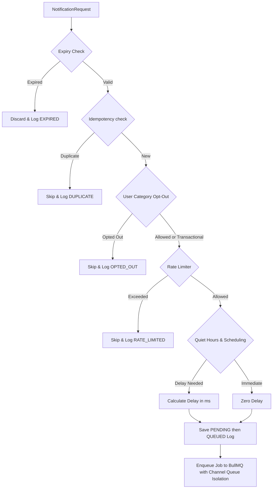
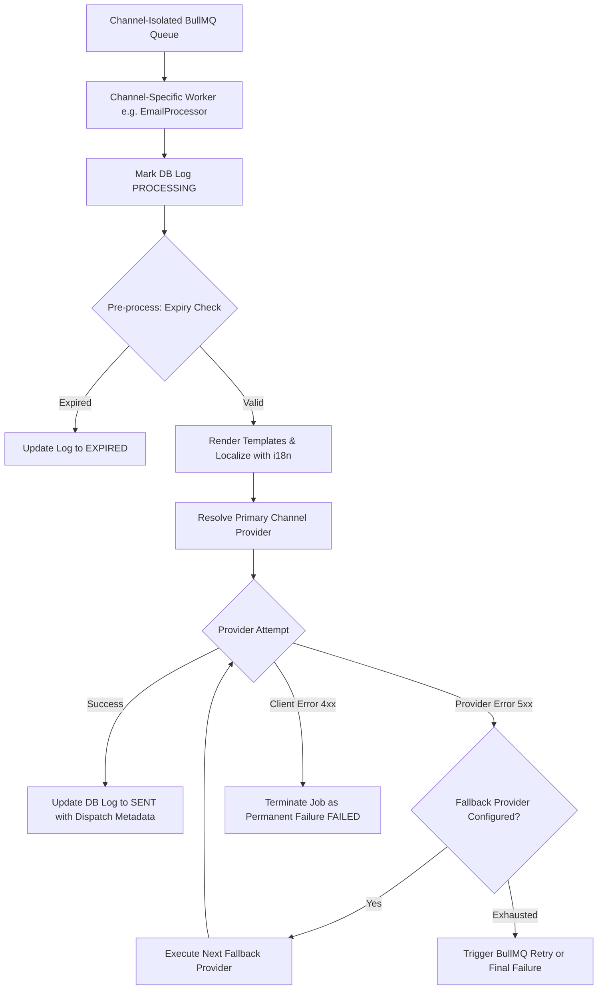

# @bts-soft/notifications

A robust, enterprise-grade, distributed multi-channel notification engine for NestJS applications. Designed in accordance with distributed systems design principles, it delivers fault tolerance, high throughput, multi-provider fallback, category-based user preferences, quiet hours scheduling, and end-to-end observability.

---

## Key Capabilities

- **13 Supported Communication Channels**:
  - **Email**: AWS SES, Twilio SendGrid, and Nodemailer (SMTP).
  - **SMS**: Twilio SMS, Vonage (Nexmo), and SMS Misr.
  - **Push**: Firebase Cloud Messaging (FCM), OneSignal, and Native Web Push (VAPID / RFC 8291).
  - **Chat & Webhooks**: WhatsApp (Twilio), Telegram Bot, Discord Webhooks, Microsoft Teams Webhooks, Facebook Messenger (Send API), Slack (Web API / Webhooks), and Generic HMAC-signed HTTP Webhooks.
  - **In-App Real-Time**: Pusher Channels.
- **Resilient Multi-Provider Fallbacks**: Automatic, transparent provider failover on network and 5xx provider failures (e.g. AWS SES -> Twilio SendGrid -> Nodemailer; Twilio SMS -> Vonage -> SMS Misr). 4xx client errors bypass fallback to avoid unnecessary traffic.
- **Granular Preference Scoping & Emergency Bypass**: Supports user opt-outs scoped to specific notification categories (`MARKETING`, `SYSTEM`, `COMMUNITY`). Critical notifications (`TRANSACTIONAL` and `SECURITY`) are protected by law and architecture and cannot be opted out of.
- **Quiet Hours & Scheduled Delivery**: Postpone non-urgent notifications during user quiet windows taking recipient timezones into account, while critical alerts bypass quiet hours immediately.
- **Idempotency & Deduplication**: Redis-backed atomic reservation with cryptographically hashed keys prevents duplicate enqueuing without exposing raw recipient identifiers.
- **Dynamic Template Engine**: Handlebars templates supporting inline strings or template files (`renderFile`) with custom helpers (`formatCurrency`, `lowercase`, `json`) and `nestjs-i18n` localization.
- **Reliable Queuing & Architecture**: Channel-isolated queues powered by BullMQ and Redis with priority tiers, backoff strategies, transactional outbox support (`NotificationOutboxRelay`), and structured audit logging.

---

## Architectural Workflow

The notification engine is partitioned into a synchronous **Pre-flight Pipeline** and an asynchronous **Worker Execution Pipeline**.

### 1. Pre-flight Pipeline



### 2. Worker Execution Pipeline



---

## Dispatch Metadata & Delivery Semantics

All channel providers implement a standard dispatch contract returning `NotificationDispatchResult`:

```typescript
export interface NotificationDispatchResult {
  provider: string;           // Actual provider that dispatched (e.g. "aws_ses", "twilio_sms")
  providerMessageId?: string; // Provider gateway message ID (e.g. SES MessageId, Twilio SID)
  rawResponse?: unknown;      // Raw response object from provider API
  dispatchedAt: Date;         // Timestamp of dispatch
  durationMs?: number;        // Outbound network duration in milliseconds
}
```

This metadata is captured automatically by the processor and stored into your `NotificationLog` repository upon completion, enabling end-to-end tracing and provider latency analysis.

---

## Configuration Reference

Set the following environment variables in your application `.env`:

| Variable Name | Type | Required | Description | Default |
| :--- | :--- | :--- | :--- | :--- |
| `EMAIL_PROVIDER` | `string` | Optional | Primary mail provider (`ses`, `twilio-mail`, `nodemailer`) | `nodemailer` |
| `AWS_SES_ACCESS_KEY_ID` | `string` | Optional | AWS IAM Access Key for Amazon SES | - |
| `AWS_SES_SECRET_ACCESS_KEY` | `string` | Optional | AWS IAM Secret Key for Amazon SES | - |
| `AWS_SES_REGION` | `string` | Optional | Target AWS Region for SES (e.g. `us-east-1`) | - |
| `SENDGRID_API_KEY` | `string` | Optional | SendGrid / Twilio Mail API Key | - |
| `EMAIL_USER` | `string` | Optional | SMTP username / credentials username | - |
| `EMAIL_PASS` | `string` | Optional | SMTP password / credentials password | - |
| `EMAIL_HOST` | `string` | Optional | SMTP host address | - |
| `EMAIL_PORT` | `number` | Optional | SMTP connection port (e.g., 465, 587) | - |
| `EMAIL_SENDER` | `string` | Optional | Outgoing "From" email address | `EMAIL_USER` |
| `SMS_PROVIDER` | `string` | Optional | Primary SMS provider (`twilio`, `vonage`, `smsmisr`) | `twilio` |
| `TWILIO_ACCOUNT_SID` | `string` | Optional | Twilio Account SID | - |
| `TWILIO_AUTH_TOKEN` | `string` | Optional | Twilio Auth Token | - |
| `TWILIO_SMS_NUMBER` | `string` | Optional | Twilio sender phone number | - |
| `TWILIO_WHATSAPP_NUMBER`| `string` | Optional | Twilio WhatsApp sender number | - |
| `VONAGE_API_KEY` | `string` | Optional | Vonage (Nexmo) API key | - |
| `VONAGE_API_SECRET` | `string` | Optional | Vonage API secret | - |
| `VONAGE_SENDER` | `string` | Optional | Vonage outbound sender ID | - |
| `SMSMISR_USERNAME` | `string` | Optional | SMS Misr account username | - |
| `SMSMISR_PASSWORD` | `string` | Optional | SMS Misr account password | - |
| `SMSMISR_SENDER` | `string` | Optional | SMS Misr approved Sender ID | - |
| `FIREBASE_SERVICE_ACCOUNT_PATH` | `string` | Optional | Path to Firebase credentials JSON file | - |
| `ONESIGNAL_APP_ID` | `string` | Optional | OneSignal App ID | - |
| `ONESIGNAL_REST_API_KEY` | `string` | Optional | OneSignal REST API Key | - |
| `WEB_PUSH_PUBLIC_KEY` | `string` | Optional | Web Push VAPID Public Key | - |
| `WEB_PUSH_PRIVATE_KEY`| `string` | Optional | Web Push VAPID Private Key | - |
| `WEB_PUSH_SUBJECT` | `string` | Optional | VAPID subject (`mailto:` or domain) | - |
| `TELEGRAM_BOT_TOKEN` | `string` | Optional | Telegram Bot API token | - |
| `DISCORD_WEBHOOK_URL` | `string` | Optional | Default Discord channel webhook | - |
| `TEAMS_WEBHOOK_URL` | `string` | Optional | Default Microsoft Teams webhook | - |
| `FB_PAGE_ACCESS_TOKEN` | `string` | Optional | Facebook Messenger Page Token | - |
| `SLACK_BOT_TOKEN` | `string` | Optional | Slack Web API Bot token | - |
| `SLACK_WEBHOOK_URL` | `string` | Optional | Default Slack Webhook URL | - |
| `PUSHER_APP_ID` | `string` | Optional | Pusher Channels Application ID | - |
| `PUSHER_KEY` | `string` | Optional | Pusher Channels client Key | - |
| `PUSHER_SECRET` | `string` | Optional | Pusher Channels client Secret | - |
| `PUSHER_CLUSTER` | `string` | Optional | Pusher Channels cluster name (e.g. `eu`) | - |

---

## Installation & Setup

### 1. Register the Module

```typescript
import { Module } from "@nestjs/common";
import { ConfigModule } from "@nestjs/config";
import { NotificationModule } from "@bts-soft/notifications";

@Module({
  imports: [
    ConfigModule.forRoot({ isGlobal: true }),
    NotificationModule.register({
      // Provide custom repositories, rate limiters, or observers here
    }),
  ],
})
export class AppModule {}
```

### 2. Dispatching Notifications

```typescript
import { Injectable } from "@nestjs/common";
import {
  NotificationService,
  ChannelType,
  NotificationCategory,
  NotificationPriority,
} from "@bts-soft/notifications";

@Injectable()
export class NotificationDeliveryService {
  constructor(private readonly notificationService: NotificationService) {}

  async sendSecurityAlert(userId: string, email: string, ipAddress: string) {
    // Transactional & Security alerts bypass user opt-out and quiet hours
    const result = await this.notificationService.sendWithResult(ChannelType.EMAIL, {
      recipientId: email,
      subject: "Security Alert: New Sign-in",
      body: "Security Notice: Sign-in from IP {{ip}} detected.",
      category: NotificationCategory.SECURITY,
      priority: NotificationPriority.CRITICAL,
      context: { ip: ipAddress },
    });

    return result;
  }

  async sendMarketingCampaign(userId: string, phone: string) {
    // Respects user opt-out and quiet hours window (delay calculated automatically)
    await this.notificationService.send(ChannelType.SMS, {
      recipientId: phone,
      body: "Flash Sale! Get 20% off today.",
      category: NotificationCategory.MARKETING,
      priority: NotificationPriority.NORMAL,
      quietHours: {
        start: "22:00",
        end: "08:00",
        timezone: "Africa/Cairo",
      },
    });
  }
}
```

---

## User Preferences & Category Opt-Out

Users can opt out of non-critical notification categories or entire channels. Critical categories (`TRANSACTIONAL` and `SECURITY`) cannot be disabled.

```typescript
import { Injectable, Inject } from "@nestjs/common";
import {
  USER_PREFERENCE_REPOSITORY,
  IUserPreferenceRepository,
  NotificationCategory,
  ChannelType,
} from "@bts-soft/notifications";

@Injectable()
export class PreferencesService {
  constructor(
    @Inject(USER_PREFERENCE_REPOSITORY)
    private readonly preferences: IUserPreferenceRepository,
  ) {}

  async unsubscribeFromMarketing(userId: string) {
    // Opt-out scoped only to MARKETING category for Email
    await this.preferences.setOptOut(userId, ChannelType.EMAIL, true, NotificationCategory.MARKETING);
  }

  async blockAllSms(userId: string) {
    // Full channel opt-out (all non-critical SMS)
    await this.preferences.setOptOut(userId, ChannelType.SMS, true);
  }
}
```

---

## Automated Testing & Quality Assurance

This package includes a comprehensive, dual-level test suite:

### 1. Full Unit Tests

Verifies all channels, fallback resilience, template compilation, rate limiting, and deduplication logic:

```bash
npm run test
```

### 2. Test Coverage Report

```bash
npm run test:cov
```

### 3. End-to-End (E2E) Integration Tests

Runs real BullMQ queue workers against an isolated Redis instance to test actual job life cycles, retry backoffs, and client error halts:

```bash
npm run test:e2e
```

---

## License

MIT (c) Omar Sabry.
